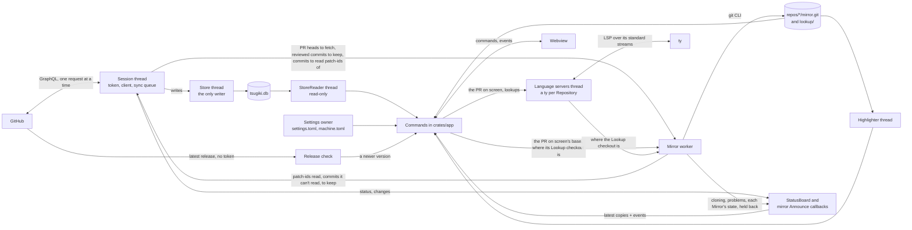

# Architecture

This page says where things are and how they talk to each other. The reasons are in the
[ADRs](adr/), and the words in **bold** are defined in [CONTEXT.md](../CONTEXT.md). It names modules and
types, not functions, so it stays true longer. Update it in the PR that moves a module or adds a thread.

## The shape

Tsugiki is a Tauri app with five crates and a webview
([ADR 0007](adr/0007-core-library-and-thin-tauri-app.md)), and a sixth crate serves only the tests:

- `crates/core` (`tsugiki-core`) knows and decides everything: GitHub, the database, the **Mirrors**, the
  diff and every rule the screens show. It has no Tauri and no webview, and plain `cargo test` tests it.
- `crates/token` (`tsugiki-token`) holds the GitHub token, `gh` and the only HTTP client, and hides tokens
  in text ([ADR 0019](adr/0019-the-token-and-the-only-code-that-sends-it-have-a-crate-of-their-own.md)).
  Nothing outside it can read the token's string. Its [README](../crates/token/README.md) says what it does
  for readers who don't read Rust.
- `crates/lsp` (`tsugiki-lsp`) talks to a language server over its standard streams, for Go to definition
  (ADR 0020). It knows nothing of PRs, Mirrors or the database: the core says which server to start, which
  documents to open and what to ask. One thread owns each server, one writes to it, two more read its
  output and its error output, and requests reach the owner as messages. Its
  [README](../crates/lsp/README.md) says what it does and what it leaves to the core.
- `crates/app` (`tsugiki-app`) is the Tauri app. It starts the core's threads, turns commands and events
  into calls on the core, and owns the window.
- `crates/webview-keys` holds the one `unsafe` call that turns off WebView2's browser shortcuts
  ([ADR 0013](adr/0013-webview2-browser-shortcuts-off-tsugiki-owns-its-keys.md)).
- `crates/test-git` runs git and builds bare remotes for the tests of `core` and `app`. Only their tests
  depend on it.
- `ui/` is a SvelteKit single-page app that renders what the core computed.

The GitHub token never leaves the core ([ADR 0005](adr/0005-token-stays-in-the-rust-core.md)). The webview
gets view models, ready to render, and asks again when the core says something changed
([ADR 0008](adr/0008-view-models-and-invalidation-over-ipc.md)).

## Threads

Each piece of shared data has one thread that writes it. Other threads send that thread messages, or read
a copy through `latest::channel` (see the Rust design rules in [AGENTS.md](../AGENTS.md)).

| Thread | Owns | Where |
|---|---|---|
| Session | The token, the GitHub client, the sync queue. Answers messages between sync steps. | `core/src/session.rs` |
| Store | The one writing SQLite connection. Only the session sends it jobs. | `core/src/store/mod.rs` |
| StoreReader | A read-only connection that the window's commands share. | `core/src/store/mod.rs` |
| Mirror worker | Every write to the Mirrors: clones, fetches of PR heads, the commits the user's Reviews covered, upkeep, and each Repository's Lookup checkout, which it moves to the PR on screen and tells readers where it is once it stops moving. Between git jobs it reads the per-file patch-ids the Stale review check compares, and hands them to the session to save, with the commits it can't read and why. | `core/src/mirror.rs` |
| Highlighter | The parsed trees of the open PR's files. | `core/src/diff/highlighter.rs` |
| Settings owner | `settings.toml` and `machine.toml`. Readers get a `latest` copy. | `core/src/settings.rs` |
| Language servers | A ty for each Repository whose PR on screen changes a Python file, with that PR's Python files open on it. Each lookup is a message, which waits for the Mirror worker's Lookup checkout and for ty, and never for the window. | `core/src/definitions.rs` |
| Log | `tsugiki.log` and the tokens to scrub from it. | `core/src/logfile.rs` |
| Text search | What the latest query found, which the window reads through `latest`. Each query runs on threads of its own, up to 4, that send it what they find, and a newer query cancels the one running. It asks the Mirror worker where the Lookup checkout is. The app doesn't start it yet (#686). | `core/src/search.rs` |
| Release check | Nothing shared. Asks GitHub Releases for a newer Tsugiki at start-up and every 6 hours, without the token, unless the settings turn it off. | `core/src/releases.rs` |

The session thread does one request to GitHub per step (`sync::Syncs`), so nothing it's asked waits for
longer than one request ([ADR 0015](adr/0015-github-sync-serial-graphql-in-tiers-the-users-work-first.md)).
The window never waits on the session to read the database: the StoreReader reads while the Store saves
([ADR 0018](adr/0018-the-window-reads-the-database-on-its-own-read-only-connection.md)).

`app/src/wiring.rs` starts all of them in `connect_core` and hands the commands what they need through
Tauri's managed state.

## How a screen gets its data

1. A screen in `ui/src/lib/state/` calls a command, such as `workbench`, through the generated
   `ui/src/lib/data/bindings.ts`.
2. The command, in `app/src/lib.rs` or `app/src/slow_commands.rs`, parses its arguments and calls a view
   model's `read` in the core with the StoreReader, such as `Workbench::read`.
3. The view model, in `core/src/workbench/`, reads the stored facts in one transaction and works out what
   the screen shows: **Needs attention**, Issue trees with their **Backports**, counts.
4. The session announces a `Change` on the `StatusBoard` for the items a sync saved. The app sends it to
   the window as the `changed` event, and each open screen that shows one of those items calls its command
   again.

App-wide status (the connection, the last sync, cloning progress, a Mirror's problem, each Mirror's state,
whether the Mirror worker holds back git, a newer version) takes a shorter path. The app keeps the newest
value in a `latest` copy for its command, then emits an event. A window that starts listening late asks the
command and still gets the newest value.

A diff takes a third path, because it is too big to send whole
([ADR 0001](adr/0001-standalone-tauri-gui-with-in-app-review.md)). The core runs `git diff` in the Mirror
and keeps the rows. The Files tab asks for the rows near what it shows, and for their highlighting from the
Highlighter.

## Where the data lives

- **What GitHub says**, and the user's own state such as Last seen, is in one SQLite file, `tsugiki.db`
  ([ADR 0010](adr/0010-one-sqlite-database-and-per-repository-mirrors.md)). The store keeps facts, not
  view models. `core/src/store/migrate.rs` moves an old file to the current schema.
- **Code** comes from each Repository's Mirror, a bare clone that Tsugiki owns. It doesn't read or write the
  user's own clones, apart from borrowing their objects when a Mirror is first cloned
  ([ADR 0002](adr/0002-tsugiki-owns-its-git-state.md)).
- **Settings** are TOML files: `settings.toml` travels between machines, and `machine.toml` doesn't
  ([ADR 0014](adr/0014-settings-in-toml-files-user-state-in-the-database-and-a-portable-mode.md)).
- `core/src/folders.rs` says where all of these go, installed or portable.

## The core's modules

`core/tests/layers.rs` lists every top-level module, lowest first, with the modules each one may use and
why. Only `store` may hold a database connection: Clippy rejects `rusqlite::Connection` anywhere else.

The big ones, in the order data passes through them:

| Module | What it does |
|---|---|
| `github/` | The GitHub client: the GraphQL queries and their answers, parsed into typed facts. It talks through a `Transport`, so tests replay recorded answers. |
| `sync/` | Decides what to ask GitHub for, how much at a time and when to pause: the first sync in tiers, then `refresh`. It saves its place after each step. |
| `store/` | Saves and reads the facts, a file for each kind: Issues, PRs, activity, Filters, sync state. [schema.md](schema.md) draws its tables. |
| `links.rs`, `conventions.rs` | Which Issues a PR fixes and which **Origin PR** a Backport comes from, read through the Repository's Conventions ([ADR 0011](adr/0011-pr-links-from-github-signals-by-repository-conventions.md)). |
| `workbench/` | The view models: the Issue list, the Issue view, the PR view and its Files tab. `attention.rs` holds Needs attention, and `review_state.rs` each PR's review state. |
| `patch_ids.rs` | Per-file patch-ids, and which files changed between the reviewed commit and the head, for the Stale review check. |
| `mirror.rs`, `mirror/` | Cloning, fetching PR heads, keeping the commits the user's Reviews covered, reading patch-ids, upkeep, moving the Lookup checkout (`mirror/lookup.rs`). |
| `diff.rs`, `diff/` | A PR's diff from its Mirror, its per-file patch-ids, NEWS entries, find in the diff, and the Highlighter. |
| `definitions.rs`, `definitions/` | Where a name is defined, which it asks a language server through `tsugiki-lsp`, in the Lookup checkout ([ADR 0020](adr/0020-go-to-definition-asks-a-language-server-which-reads-a-lookup-checkout.md)). Each server has a module of its own: `definitions/ty.rs` for Python. |
| `highlight.rs`, `highlight/` | tree-sitter highlighting, one table row per language ([docs/highlighting.md](highlighting.md)). |
| `search.rs`, `search/` | Text search over the open PR's code at its head, on ripgrep's crates, in the Lookup checkout and the Mirror (ADR 0020). |
| `session.rs` | The session thread and the messages it takes. |
| `status.rs` | App-wide status and the `StatusBoard` that announces it. |

The smaller ones say what they do in their first `//!` line.

## Where tests draw the line

- `token/src/live.rs` holds everything that touches the real network and `gh`, and the core's
  `github/live.rs` runs the real `git` and hands requests to the token crate's client. Tests swap the
  network and `gh` for the replayer in `github/replay.rs`, and `github/record.rs` captures new answers
  ([ADR 0009](adr/0009-testing-and-full-coverage.md)).
- `app/src/wiring.rs` sets up the commands and events on any Tauri runtime, so its tests run on Tauri's
  mock runtime without a window. `app/src/startup.rs` opens the real window, and only `just smoke` tests it.
  What it decides goes in a module its tests can reach, such as `app/src/first_frame.rs`, which paints the
  window before it shows.
- The UI's state files have Vitest tests beside them, with the bindings mocked. `ui/e2e/` runs the built UI
  in Chromium and WebKit with Playwright, with Tauri's IPC mocked in `ui/e2e/mock-core.ts`.
- `just stale-bindings` fails when `bindings.ts` no longer matches the Rust commands. `just bindings`
  writes it again.
