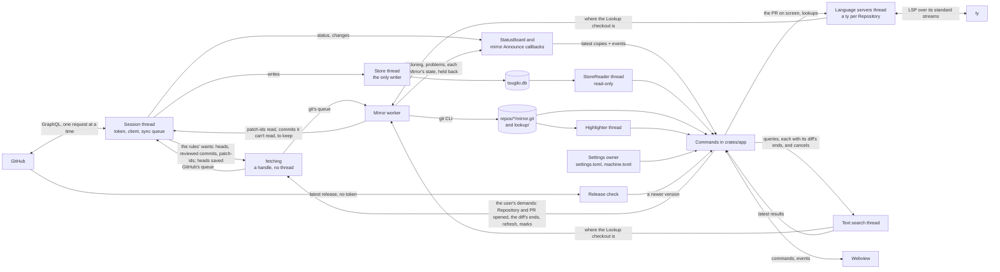

# Architecture

This page says where things are and how they talk to each other. The reasons are in the
[ADRs](adr/), and the words in **bold** are defined in [CONTEXT.md](../CONTEXT.md). It names modules and
types, not functions, so it stays true longer. Update it in the PR that moves a module or adds a thread.

## The shape

Tsugiki is a Tauri app with five crates and a webview
([ADR 0007](adr/0007-core-library-and-thin-tauri-app.md)), and a sixth crate serves only the tests:

- `crates/core` (`tsugiki-core`) knows and decides everything: GitHub, the database, the **Mirrors**, the
  diff and every rule the screens show. It has no Tauri and no webview, and plain `cargo test` tests it.
- `crates/token` (`tsugiki-token`) holds the GitHub token, `gh` and the only HTTP client, and hides tokens
  in text ([ADR 0019](adr/0019-the-token-and-the-only-code-that-sends-it-have-a-crate-of-their-own.md)).
  Nothing outside it can read the token's string. Its [README](../crates/token/README.md) says what it does
  for readers who don't read Rust.
- `crates/lsp` (`tsugiki-lsp`) talks to a language server over its standard streams, for Go to definition
  (ADR 0020). It knows nothing of PRs, Mirrors or the database: the core says which server to start, which
  documents to open and what to ask. One thread owns each server, one writes to it, two more read its
  output and its error output, and requests reach the owner as messages. Its
  [README](../crates/lsp/README.md) says what it does and what it leaves to the core. Its `testing` feature
  also builds `tsugiki-fake-server`, a fake server the core's tests start as a process.
- `crates/app` (`tsugiki-app`) is the Tauri app. It starts the core's threads, turns commands and events
  into calls on the core, and owns the window.
- `crates/webview-keys` holds the one `unsafe` call that turns off WebView2's browser shortcuts
  ([ADR 0013](adr/0013-webview2-browser-shortcuts-off-tsugiki-owns-its-keys.md)).
- `crates/test-git` holds the test helpers that several crates share and that use no crate's types. It runs
  git and builds bare remotes and mirrors, gives the tests their folders under `.temp`, which go when a test
  passes, names the language servers they start, and checks generated files. Only tests depend on it. The
  helpers that use a crate's types are in its `testing` module, which other crates' tests reach through its
  `testing` feature.
- `ui/` is a SvelteKit single-page app that renders what the core computed.

The GitHub token never leaves the core ([ADR 0005](adr/0005-token-stays-in-the-rust-core.md)). The webview
gets view models, ready to render, and asks again when the core says something changed
([ADR 0008](adr/0008-view-models-and-invalidation-over-ipc.md)).

## Threads

Each piece of shared data has one thread that writes it. Other threads send that thread messages, or read
a copy through `latest::channel` (see the Rust design rules in [AGENTS.md](../AGENTS.md)).

| Thread | Owns | Where |
|---|---|---|
| Session | The token, the GitHub client, the sync queue, and the hour's points the client sums from each answer's cost. Takes the user's demands between sync steps. | `core/src/session.rs` |
| Store | The one writing SQLite connection. Only the session sends it jobs. | `core/src/store/mod.rs` |
| StoreReader | A read-only connection that the window's commands share. | `core/src/store/mod.rs` |
| Mirror worker | Every write to the Mirrors: clones, fetches of PR heads, the commits the user's Reviews covered, upkeep, and each Repository's Lookup checkout, which it moves to the PR on screen and tells readers where it is once it stops moving. Between git jobs it reads the per-file patch-ids the Stale review check compares, and hands them to the session to save, with the commits it can't read and why. It ranks its queue as `fetching` says: the user's demands first, a move of the Lookup checkout and then the heads of the PRs they opened, in a fetch of their own; then the rules' wants, each the whole set for a Repository, which replaces the last; then clones and upkeep. | `core/src/mirror.rs` |
| Highlighter | The parsed trees of the open PR's files, and of the few other files the Definition peek and the file view showed whole last. | `core/src/diff/highlighter.rs` |
| Settings owner | `settings.toml` and `machine.toml`. Readers get a `latest` copy. | `core/src/settings.rs` |
| Language servers | A server for each Repository and language: ty and clangd start when the PR on screen changes a Python or C file, and rust-analyzer on the first lookup in Rust. Each has the PR's files in its language open on it, and clangd the last 16 other files a lookup asked in too, as it answers only in an open file. Each lookup is a message, which waits for the Mirror worker's Lookup checkout and for the server to start, and never for the window. The thread sends the server the request and goes on: a thread of the lookup's own waits for the answer and hands it back as a message, and a newer lookup or a cancel cancels the one running. Between messages it stops each server no lookup has reached for the idle time, which `machine.toml` sets. A thread of each server's own watches it: it reads how far clangd's index has got from its `$/progress` and tells this thread, which tells a lookup that answered while clangd indexed, and asks clangd again for it once the index is built; it tells this thread when a server exits on its own; and from clangd's diagnostics, or a minute without a report of its index, it tells this thread of a problem clangd runs with. This thread keeps each server's row in Settings › Advanced, its state, last problem and version, and hands the rows to the window through a `latest` channel and an event. A path changed in Settings stops the server it replaces, and a thread of its own runs the new one with `--version`. | `core/src/definitions.rs` |
| Log | `tsugiki.log` and the tokens to scrub from it. | `core/src/logfile.rs` |
| Text search | What the latest query found, which the window reads through `latest`. Each query runs on threads of its own, up to 4, that send it what they find, and a newer query or the window's cancel cancels the one running. Each query names the ends of the diff it searches, and asks the Mirror worker where the Lookup checkout is, which the Files tab's read of that diff moved there: it searches nothing if the checkout is at another diff, and the window then reads the diff again once. It never moves the checkout, as two queries on their own threads would send their moves in either order. The rail's Search asks it queries, and asks for the state each time it says the state may have changed. | `core/src/search.rs` |
| Release check | Nothing shared. Asks GitHub Releases for a newer Tsugiki at start-up and every 6 hours, without the token, unless the settings turn it off. | `core/src/releases.rs` |

`fetching` is a handle with no thread. The app and the session send each request for GitHub or the Mirrors
through it, and the two queues behind it keep their owners
([ADR 0022](adr/0022-the-users-demands-and-the-rules-wants-go-through-one-handle-to-two-queues.md)). The user
asks with demands, urgent, the newer winning; the rules in `work` state wants, the whole set for a Repository
each time. The session thread does one request to GitHub per step (`sync::Syncs`) and takes each demand
between two steps, so nothing it's asked waits for longer than one request
([ADR 0015](adr/0015-github-sync-serial-graphql-in-tiers-the-users-work-first.md)).
The window never waits on the session to read the database: the StoreReader reads while the Store saves
([ADR 0018](adr/0018-the-window-reads-the-database-on-its-own-read-only-connection.md)).

`app/src/wiring.rs` starts all of them in `connect_core` and hands the commands what they need through
Tauri's managed state.

## How a screen gets its data

1. A screen in `ui/src/lib/state/` calls a command, such as `workbench`, through the generated
   `ui/src/lib/data/bindings.ts`.
2. The command, in `app/src/lib.rs` or `app/src/slow_commands.rs`, parses its arguments and makes one call
   into the core: a view model's `read` with the StoreReader, such as `Workbench::read`, or, for a screen
   whose read can find data missing, the screen's call in `core/src/calls.rs`, such as
   `PullRequestWork::pr_files`.
3. The view model, in `core/src/workbench/`, reads the stored facts in one transaction, has `work` judge
   them, and works out what the screen shows: **Needs attention**, Issue trees with their **Backports**,
   counts. Its `read` sends nothing.
4. The screen's call works out what the read lacks, queues through `fetching` the job that brings it, and
   answers. An answer that says its data is on the way holds that job
   ([ADR 0023](adr/0023-the-core-works-out-what-a-screens-read-lacks-and-a-pending-answer-holds-its-job.md)).
   The Files tab's read says what the Mirror lacks and which diff it shows. Its call queues the clone of a
   Repository the settings list, the PR's head first when the Mirror lacks it, or a read of the PR's
   Conversation when Tsugiki knows no head, and moves the Lookup checkout to the diff's ends, where text
   search looks for it. Opening a PR reads its Conversation each time. The store keeps the head a
   Conversation names for a PR kept with none, and a demand for a read already waiting or under way in the
   session's queue shares that read.
5. The session announces a `Change` on the `StatusBoard` for the items a sync saved. The app sends it to
   the window as the `changed` event, and each open screen that shows one of those items calls its command
   again. The settings owner's thread hands the session each Repository's settings a change saves
   otherwise, in the order it saves them. Those a hand edit changed, as new Conventions or Filters, announce
   a `Change` that names no item, and the Repository's lists read their items again.

App-wide status (the connection, the last sync, the hour's GitHub points, cloning progress, a Mirror's
problem, each Mirror's state, whether the Mirror worker holds back git, a newer version) takes a shorter
path. The app keeps the newest value in a `latest` copy for its command, then emits an event. A window that
starts listening late asks the command and still gets the newest value.

A diff takes a third path, because it is too big to send whole
([ADR 0001](adr/0001-standalone-tauri-gui-with-in-app-review.md)). The core runs `git diff` in the Mirror
and keeps the rows. The Files tab asks for the rows near what it shows, and for their highlighting from the
Highlighter.

Keys take a fourth path, its defaults fixed when the app is built. `core/src/keys.rs` lists each action the
user can bind, with its default key and where it works, and `npm run bindings` writes that table to
`ui/src/lib/data/keymap.ts`, a file apart from `bindings.ts`, which the UI's tests mock whole. The user's
remaps come with the settings: `core/src/keys.rs` reads each line of `[keys]` into a typed key, and the
window's settings hand them to `ui/src/lib/state/keymap.svelte.ts`, which lays them over the defaults.
Screens bind actions, and that module finds the action on a key.

## Where the data lives

- **What GitHub says**, and the user's own state such as Last seen, is in one SQLite file, `tsugiki.db`
  ([ADR 0010](adr/0010-one-sqlite-database-and-per-repository-mirrors.md)). The store keeps facts, not
  view models. `core/src/store/migrate.rs` moves an old file to the current schema.
- **Code** comes from each Repository's Mirror, a bare clone that Tsugiki owns. It doesn't read or write the
  user's own clones, apart from borrowing their objects when a Mirror is first cloned
  ([ADR 0002](adr/0002-tsugiki-owns-its-git-state.md)).
- **Settings** are TOML files: `settings.toml` travels between machines, and `machine.toml` doesn't
  ([ADR 0014](adr/0014-settings-in-toml-files-user-state-in-the-database-and-a-portable-mode.md)).
- `core/src/folders.rs` says where all of these go, installed or portable.

## The core's modules

`core/tests/layers.rs` lists every top-level module, lowest first, with the modules each one may use and
why. Only `store` may hold a database connection: Clippy rejects `rusqlite::Connection` anywhere else.

The big ones, in the order data passes through them:

| Module | What it does |
|---|---|
| `github/` | The GitHub client: the GraphQL queries and their answers, parsed into the types of `facts`. It talks through a `Transport`, so tests replay recorded answers. It sums the points each answer cost this hour (`points.rs`). |
| `facts.rs`, `facts/` | The facts `work` judges: what GitHub says of each Issue and PR, the patch-ids the Mirror worker reads, and `WorkFacts`, the bundle a screen reads from the store. Neither the client nor the store owns them. |
| `sync/` | Decides what to ask GitHub for, how much at a time and when to pause: the first sync in tiers, then `refresh`. It saves its place after each step. |
| `store/` | Saves and reads the facts, a file for each kind: Issues, PRs, activity, Filters, sync state. [schema.md](schema.md) draws its tables. It keeps the links each PR names under each Conventions, which `links` works out as the PR is saved (`pr_links.rs`). A `Snapshot` is one read transaction for a view that works out what to read next from what it read, as the Inbox does. |
| `links.rs`, `conventions.rs` | Which Issues a PR fixes and which **Origin PR** a Backport comes from, read through the Repository's Conventions ([ADR 0011](adr/0011-pr-links-from-github-signals-by-repository-conventions.md)). |
| `work.rs`, `work/` | The functional core: it takes `facts` and returns values. By Issue or PR number it judges what's on the **Workbench** in its own right (`reach.rs`), why it **Needs attention** (`causes.rs`) and each PR's review state (`review_state.rs`). By Repository it works out **Reach** from those and the links, and from Reach the heads the Mirror fetches, the commits it reads patch-ids of, and the checks the store keeps. `sync` and `session` use it, never `workbench`. |
| `workbench/` | Groups what `work` judges into the Workbench's items, Issue trees with their PRs and **Backports**, and sums each item's Needs attention and its part in Mark Seen over its tree (`attention.rs`). Builds the view models: the Issue list, the Issue view, the PR view and its Files tab, quick open's search (`quick_open.rs`), and the **Inbox** a page at a time (`inbox.rs`), which walks the updates down from where the page starts and reads the trees of what it meets through the links the store keeps and the store's `Snapshot`, so a page costs the same on a cache of any age. A read sends nothing, and `layers.rs` keeps it from `mirror` and `fetching`. |
| `fetching.rs` | The one entry point for requests for data: the user's demands and the rules' wants, handed to the session's GitHub queue or the Mirror worker's git queue ([ADR 0022](adr/0022-the-users-demands-and-the-rules-wants-go-through-one-handle-to-two-queues.md)). |
| `calls.rs` | Each screen's call that can find data missing, as the Files tab's does: it reads through a view model, queues through `fetching` the job for what the read lacks, and answers. An answer that waits for data holds the job's `Queued`, which only `fetching` makes ([ADR 0023](adr/0023-the-core-works-out-what-a-screens-read-lacks-and-a-pending-answer-holds-its-job.md)). |
| `patch_ids.rs` | Per-file patch-ids, and which files changed between the reviewed commit and the head, for the Stale review check. |
| `mirror.rs`, `mirror/` | Cloning, fetching PR heads, keeping the commits the user's Reviews covered, reading patch-ids, upkeep, moving the Lookup checkout (`mirror/lookup.rs`). |
| `mirror_source.rs` | Where each Repository's mirror gets its objects, which `settings` keeps and `mirror` clones by. |
| `diff.rs`, `diff/` | A PR's diff from its Mirror, its per-file patch-ids, NEWS entries, find in the diff, and the Highlighter. |
| `definitions.rs`, `definitions/` | Where a name is defined, which it asks a language server through `tsugiki-lsp`, in the Lookup checkout ([ADR 0020](adr/0020-go-to-definition-asks-a-language-server-which-reads-a-lookup-checkout.md)). `definitions/server.rs` runs one server on the checkout and writes its log, `definitions/health.rs` holds each server's state, last problem and version, and checks a path the user sets, and each server has a module of its own for how it starts: `definitions/ty.rs` for Python, `definitions/rust_analyzer.rs` for Rust and `definitions/clangd.rs` for C, which writes clangd's compile database in a Repository with CPython's layout. |
| `highlight.rs`, `highlight/` | tree-sitter highlighting, one table row per language ([docs/highlighting.md](highlighting.md)). |
| `search.rs`, `search/` | Text search over the open PR's code at its head, on ripgrep's crates, in the Lookup checkout and the Mirror (ADR 0020). |
| `session.rs` | The session thread, which takes the messages `fetching` sends it, and after each sync step that saves hands `fetching` the rules' wants. |
| `status.rs` | App-wide status and the `StatusBoard` that announces it. |

The smaller ones say what they do in their first `//!` line.

## Where tests draw the line

- `token/src/live.rs` holds everything that touches the real network and `gh`, and the core's
  `github/live.rs` runs the real `git` and hands requests to the token crate's client. Tests swap the
  network and `gh` for the replayer in `github/replay.rs`, and `github/record.rs` captures new answers
  ([ADR 0009](adr/0009-testing-and-full-coverage.md)).
- `app/src/wiring.rs` sets up the commands and events on any Tauri runtime, so its tests run on Tauri's
  mock runtime without a window. `app/src/startup.rs` opens the real window, and only `just smoke` tests it.
  What it decides goes in a module its tests can reach, such as `app/src/first_frame.rs`, which paints the
  window before it shows.
- The UI's state files have Vitest tests beside them, with the bindings mocked. `ui/e2e/` runs the built UI
  in Chromium and WebKit with Playwright, with Tauri's IPC mocked in `ui/e2e/mock-core.ts`.
- `just stale-bindings` fails when `bindings.ts` no longer matches the Rust commands, or `keymap.ts` the
  core's key table. `just bindings` writes both again.
