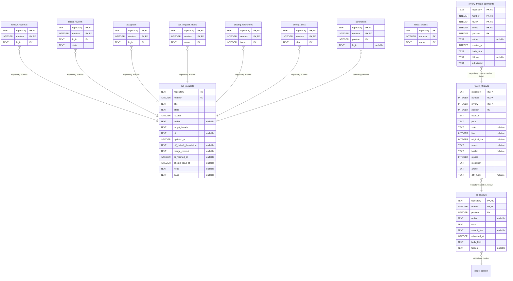
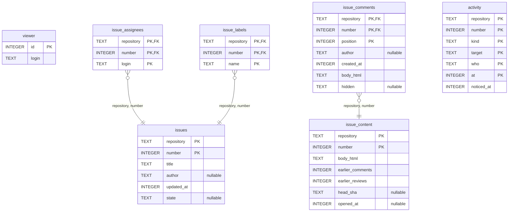
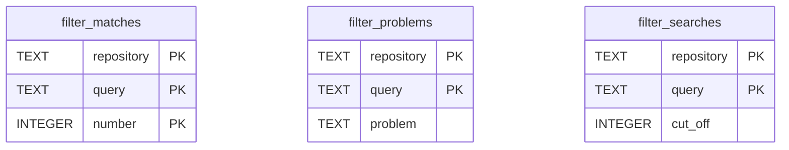
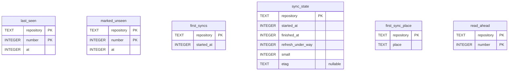

# The database schema

<!-- Written by `just schema` from crates/core/src/store/migrate.rs. Don't edit it by hand. -->

The tables of `tsugiki.db` as its migrations leave them, cache apart from state
([ADR 0010](adr/0010-one-sqlite-database-and-per-repository-mirrors.md)). `PK` marks a table's primary key
and `FK` a column that points at another table's row, and a column that may hold null says so. A line joins
the table that points to the one it points at, and its label names the columns.

## The cache: what GitHub says

### PRs

### Issues, their timelines and the viewer

## State: the user's and the sync's

### Filters

### Last seen, Marked unseen and the sync's place

